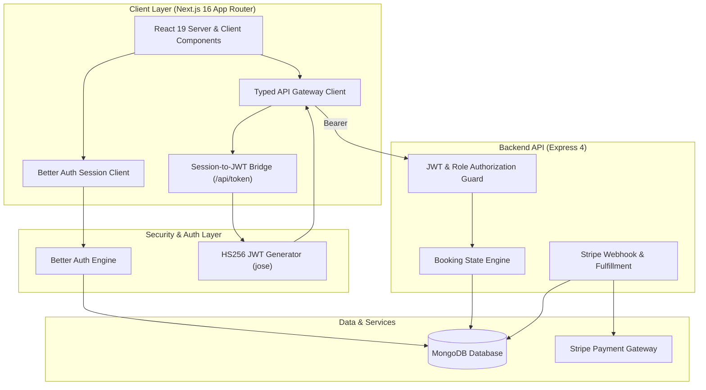

# FixMate - On-Demand Repair Marketplace (Client)

<div align="center">

[](https://fix-mate-flame.vercel.app/)
[](https://fix-mate-server-teal.vercel.app/)
[](https://nextjs.org/)
[](https://react.dev/)
[](https://www.typescriptlang.org/)
[](https://tailwindcss.com/)
[](LICENSE)

**A full-stack, enterprise-grade on-demand repair service marketplace connecting homeowners with vetted local technicians.**

[Explore Live Demo](https://fix-mate-flame.vercel.app/) • [API Server Repository](https://github.com/CodeWithTanim/FixMate-Server) • [Report Issue](https://github.com/CodeWithTanim/FixMate/issues)

</div>

---

## 🌟 Executive Summary

**FixMate** solves the reliability and transparency deficit in the local repair market. It introduces a **strict pay-after-completion model** where customers pay zero upfront fees, track their repair through an immutable timestamped state machine, and settle invoices via Stripe Checkout only when repairs are completed to full satisfaction.

Built with **Next.js 16 (App Router)**, **React 19**, **Tailwind CSS v4**, and **TypeScript**, the frontend delivers an ultra-fast, accessible, and high-conversion user experience with role-based dashboard workflows for **Customers**, **Technicians**, and **Administrators**.

---

## 🚀 Live Deployments

| Component | Target URL | Status | Description |
| :--- | :--- | :---: | :--- |
| **Frontend Web App** | [https://fix-mate-flame.vercel.app/](https://fix-mate-flame.vercel.app/) |  | Production Next.js 16 client deployed on Vercel Edge |
| **Backend REST API** | [https://fix-mate-server-teal.vercel.app/](https://fix-mate-server-teal.vercel.app/) |  | High-performance Express API deployed on Vercel Serverless |

---

## ⚡ Key Engineering Highlights

- **Multi-Role Role-Based Architecture (RBAC)**: Distinct permissions, navigational layouts, and protected workflows for Customers, Technicians, and Platform Admins.
- **Pay-After-Completion Settlement**: Zero advance fees. Technicians inspect and complete the job, input the final verified billable amount, and the customer settles securely through Stripe Checkout.
- **Finite State Machine Lifecycle**: Enforces strict status transitions (`requested` ➔ `accepted`/`rejected` ➔ `in-progress` ➔ `completed` / `cancelled`) with race condition prevention and duplicate booking blocking.
- **Comprehensive Audit Trail**: Timestamped history on every booking capturing transitions, actor roles, actor emails, and diagnostic notes.
- **Stripe Test Checkout & Webhooks**: Complete payment lifecycle with signature-verified webhooks, auto-reconciliation, receipt generation, and transaction ledger logging.
- **Technician Pro Membership ($29/mo)**: Integrated recurring subscription tier with 0% platform commissions, priority service placement, verified badge, and unlimited service listings.
- **Security & Authorization Bridge**: Better Auth for session management combined with an internal HS256 JWT authorization bridge to communicate with the standalone Express backend.
- **Accessible & Responsive UX**: WAI-ARIA compliant modal focus traps (`useFocusTrap`), light/dark theme persistence, custom branded petrol/jade design system (`#0B3638`, `#18756B`), and 100% mobile responsiveness.

---

## 🏗️ Architecture & Data Flow



---

## 👥 Multi-Role User Workflows

### 1. 🧑‍💼 Customer Portal
- **Service Catalog**: Filter by 7 specialized categories (*Smartphone*, *Laptop*, *HVAC/AC*, *Refrigerator*, *TV/Display*, *Washing Machine*, *Electrical*), filter by On-Site vs Workshop service mode, and search with debounced queries.
- **Booking Submission**: Submit repair requests with photo attachments, problem descriptions, and calendar-aware scheduling.
- **Live Status Tracking**: View real-time timeline milestones with full technician inspection notes.
- **Frictionless Payment**: One-click Stripe checkout upon repair completion; view/print itemized receipts anytime.
- **Verified Reviews**: Leave 1–5 star ratings and reviews on completed and settled services.

### 2. 🔧 Technician Workbench
- **Incoming Queue**: Real-time triage of pending repair requests with accept/reject capability.
- **Job Execution Flow**: Transition bookings to `in-progress` upon physical inspection and `completed` with final itemized repair pricing.
- **Service Management**: Create, update, toggle availability, and monitor admin approval statuses. Standard tier supports up to 5 listings; Pro tier offers unlimited listings.
- **Pro Membership Upgrade**: Dedicated subscription page ($29/month) featuring 0% platform fee, priority algorithm placement, verified Pro badge, and instant Checkout activation.

### 3. 🛡️ Platform Administration
- **Quality Moderation**: Moderate newly submitted technician services and updates before public listing.
- **Global Booking Surveillance**: View every active, completed, or disputed repair order across the entire platform.
- **User Role Management**: Search users and update privileges (`customer`, `technician`, `admin`) with safety guards preventing accidental admin self-demotion.
- **Financial Ledger**: Real-time platform revenue ledger with gross volume, technician payouts, and commission tracking.

---

## 🔑 Demo Accounts for Evaluation

You can test all three roles immediately on the [Live Application](https://fix-mate-flame.vercel.app/sign-in) using the pre-seeded credentials:

| Role | Email | Service Domain / Area | Features to Test |
| :--- | :--- | :--- | :--- |
| **Platform Admin** | `admin@fixmate.dev` | Complete Platform Control | Service moderation, user role promotion, platform revenue ledger |
| **Technician 1** | `rahim.tech@fixmate.dev` | Smartphones & Laptops (Dhaka Central) | Request queue, status transition, adding new repair services |
| **Technician 2** | `sarah.appliances@fixmate.dev` | HVAC & Refrigerators (Banani/Gulshan) | Active bookings, completing jobs with final billing |
| **Customer** | `customer@fixmate.dev` | Residential Client | Book service, track timeline, test Stripe checkout, leave review |

> **Password**: For evaluation access, demo account passwords can be set during local seed execution via `DEMO_USER_PASSWORD` or obtained securely via private evaluation handoff.

---

## 📂 Project Directory Structure

```text
FixMate/
├── app/
│   ├── (auth)/                       # Centered authentication layout
│   │   ├── sign-in/page.tsx          # Login with return redirect support
│   │   └── sign-up/page.tsx          # Multi-role registration with password policy
│   ├── (public)/                     # Public browsing routes with shared navbar & footer
│   │   ├── page.tsx                  # Bento grid, hero slider, testimonials, categories
│   │   ├── about/page.tsx            # Transparent 4-step repair lifecycle & guarantees
│   │   ├── privacy/page.tsx          # Privacy policy
│   │   ├── terms/page.tsx            # Terms of service
│   │   └── services/                 # Catalog discovery, pagination & detail views
│   ├── api/
│   │   ├── auth/[...all]/route.ts    # Better Auth endpoints
│   │   └── token/route.ts            # Secure session-bound HS256 JWT issuer
│   ├── dashboard/                    # Role-protected dashboard layouts & views
│   │   ├── layout.tsx                # Dynamic sidebar, user profile & navigation
│   │   ├── customer/                 # Bookings, invoices & spending stats
│   │   ├── technician/               # Service listings, job queue & $29 Pro upgrade
│   │   ├── admin/                    # Service moderation, user roles, financial ledger
│   │   └── profile/page.tsx          # Avatar upload & profile details editor
│   ├── payment/
│   │   ├── success/page.tsx          # Stripe checkout verification return screen
│   │   └── cancel/page.tsx           # Cancelled checkout return screen
│   ├── error.tsx                     # Global themed diagnostic error boundary
│   ├── not-found.tsx                 # Custom 404 handler with quick navigation
│   ├── globals.css                   # Tailwind v4 configuration and theme variables
│   └── layout.tsx                    # Root layout with theme provider & toasts
├── components/                       # Modular, accessible UI components
│   ├── BookingRequestModal.tsx       # Focus-trapped repair scheduling modal
│   ├── JobTimelineModal.tsx          # Visual milestone & audit trail modal
│   ├── LeaveReviewModal.tsx          # Star-rating and customer feedback modal
│   ├── HomeCategoriesBento.tsx       # Interactive 7-category visual grid
│   ├── HomeHeroSlider.tsx            # Auto-playing hero carousel with hardware visuals
│   ├── ServiceCard.tsx               # Service card with pricing, badges & ratings
│   └── ui/                           # Primitives: buttons, dialogs, badges, inputs
├── lib/
│   ├── api/                          # Typed backend HTTP client
│   ├── auth.ts                       # Better Auth server configuration
│   ├── auth-client.ts                # Better Auth React client hooks
│   ├── auth-guards.ts                # Route protection & role boundary helpers
│   ├── useFocusTrap.ts               # WAI-ARIA keyboard navigation hook
│   └── utils.ts                      # Currency, date & validation helpers
└── scripts/
    └── seed.mjs                      # Production-ready database seed script
```

---

## 🛠️ Tech Stack & Dependencies

| Category | Technologies |
| :--- | :--- |
| **Core Framework** | [Next.js 16.4 (App Router & Turbopack)](https://nextjs.org/), [React 19](https://react.dev/) |
| **Language** | [TypeScript 5](https://www.typescriptlang.org/) (Strict Mode) |
| **Styling & Design** | [Tailwind CSS v4](https://tailwindcss.com/), Petrol & Jade Palette, [Lucide Icons](https://lucide.dev/) |
| **Authentication** | [Better Auth](https://www.better-auth.com/) with MongoDB Adapter |
| **Authorization** | Short-lived HS256 JWTs via [jose](https://github.com/panva/jose) |
| **Payments** | [Stripe](https://stripe.com/) Checkout Sessions & Customer Invoicing |
| **Feedback & UX** | `react-hot-toast`, accessible dialog focus traps |

---

## 💎 Code Quality & Production Build

The client codebase is strictly typed and validated against production standards:

```bash
# Run TypeScript static typecheck (0 errors)
npm run typecheck

# Run ESLint validation
npm run lint

# Build production bundle (28/28 routes verified)
npm run build
```

---

## 💻 Local Development Setup

### 1. Prerequisites
- Node.js 20+ (LTS recommended)
- MongoDB instance (local or [MongoDB Atlas](https://www.mongodb.com/atlas))
- Running FixMate API Server ([FixMate-Server Repository](https://github.com/CodeWithTanim/FixMate-Server))

### 2. Clone & Install
```bash
git clone https://github.com/CodeWithTanim/FixMate.git
cd FixMate
npm install
```

### 3. Configure Environment Variables
Create a `.env.local` file in the root directory:

```env
# Application URLs
NEXT_PUBLIC_API_URL=https://fix-mate-server-teal.vercel.app
BETTER_AUTH_URL=https://fix-mate-flame.vercel.app
BETTER_AUTH_TRUSTED_ORIGINS=https://fix-mate-flame.vercel.app,http://localhost:3000

# Authentication & Security
BETTER_AUTH_SECRET=your_super_secret_better_auth_key_min_32_chars_long
JWT_SECRET=your_shared_jwt_secret_with_express_backend_min_32_chars
JWT_ISSUER=https://fix-mate-flame.vercel.app
JWT_AUDIENCE=fixmate-api

# Database
MONGODB_URI=mongodb+srv://<username>:<password>@cluster.mongodb.net/fixmate-db?retryWrites=true&w=majority
MONGODB_DBNAME=fixmate-db

# Payments
NEXT_PUBLIC_STRIPE_PUBLISHABLE_KEY=pk_test_your_stripe_publishable_key

# Database Seeder
DEMO_USER_PASSWORD=YourSecureDemoPassword123!
```

### 4. Seed the Database
Populate the database with demo accounts, approved service listings, and multi-state test bookings:
```bash
npm run seed
```

### 5. Launch Development Server
```bash
npm run dev
```
Open [http://localhost:3000](http://localhost:3000) in your browser.

---

## 🔒 Security Best Practices Implemented

1. **No Client-Exposed Secrets**: Server-side secrets (`BETTER_AUTH_SECRET`, `JWT_SECRET`, database URIs) are never prefixed with `NEXT_PUBLIC_` and never bundled into client JavaScript.
2. **Open Redirect Defense**: All post-login and callback URLs are filtered through `getSafeRedirectUrl`, blocking protocol-relative URLs (`//evil.com`), encoded slashes, and control characters.
3. **Session-Bound JWT Bridge**: Client calls `/api/token` with an active Better Auth HTTP-only cookie. The server validates the session and signs a short-lived (15 min) JWT with the exact user role, which is presented to the Express backend.
4. **WAI-ARIA Accessibility**: Modal dialogs use `useFocusTrap` to constrain keyboard navigation within open modals and restore focus to trigger elements upon closing.

---

## 👤 Author & Full-Stack Profile

**MD. SAMIUR RAHMAN TANIM**
*Full Stack Developer | Modern Web Architect*

- 🌐 **Live Client**: [https://fix-mate-flame.vercel.app/](https://fix-mate-flame.vercel.app/)
- ⚙️ **Live Backend**: [https://fix-mate-server-teal.vercel.app/](https://fix-mate-server-teal.vercel.app/)
- 🐙 **GitHub**: [@CodeWithTanim](https://github.com/CodeWithTanim)
- 💼 **LinkedIn**: [Samiur Rahman Tanim](https://www.linkedin.com/in/codewithtanim)
- 📧 **Contact**: [codewithtanim+support@gmail.com](mailto:codewithtanim+support@gmail.com)

---

<div align="center">
  <sub>Built with passion for clean code, reliability, and modern web standards. © FixMate Platform.</sub>
</div>
